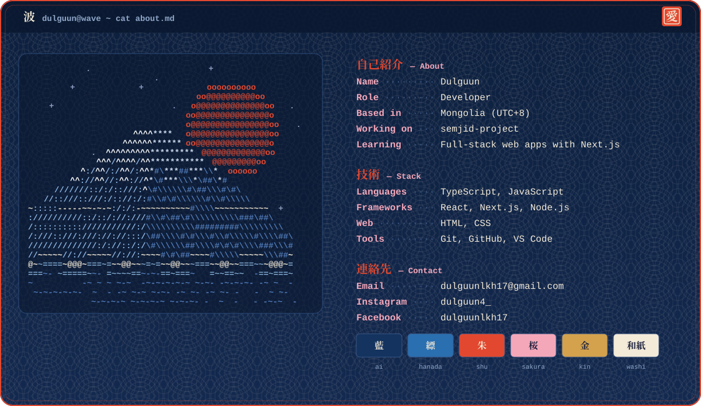
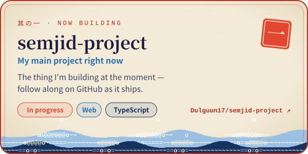
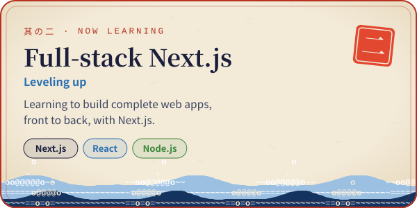
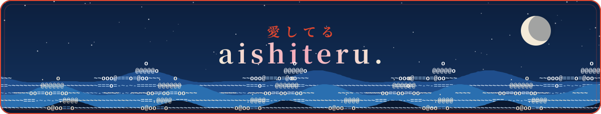

  
  
  
  

## 🌊 自己紹介 · About

## 🏮 Projects

  
  

## ⛩️ 技術 · Tech stack

  

## 🎐 Activity

  

  

  <picture>
    <source media="(prefers-color-scheme: dark)" srcset="https://raw.githubusercontent.com/Dulguun17/Dulguun17/output/snake-wave-dark.svg" />
    <source media="(prefers-color-scheme: light)" srcset="https://raw.githubusercontent.com/Dulguun17/Dulguun17/output/snake-wave-light.svg" />
    
  </picture>

